<p align="center">
  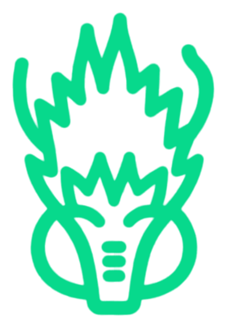<br>
  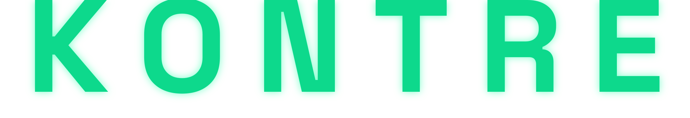
</p>

<p align="center">
  <strong>A next-generation, on-device digital wellbeing guardian built with Kotlin & Jetpack Compose.</strong><br>
  Target SDK 35 • Android 15 Ready • 100% Air-Gapped Silicon • Zero Cloud Telemetry
</p>

<p align="center">
  
  
  
  
  
</p>

---

## 📸 Visual Showcase & App Experience

Kontre pairs surgical short-form blocking with a high-end, cyberpunk emerald design system and a gamified dragon evolution engine.

### Core Interface

| ⚡ Splash / Awakening | 🎛️ Platform Toggles | 🎯 Limits & Target Ceiling |
| :---: | :---: | :---: |
| 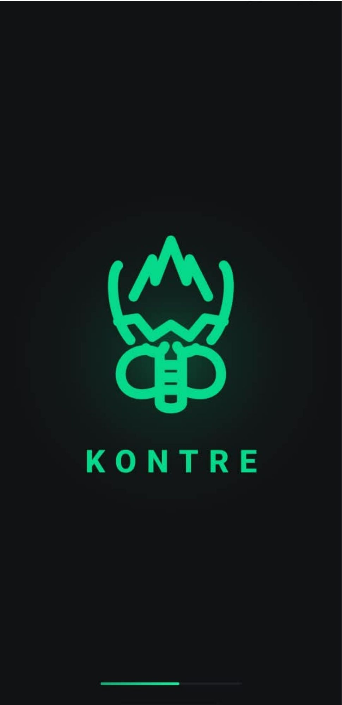 | 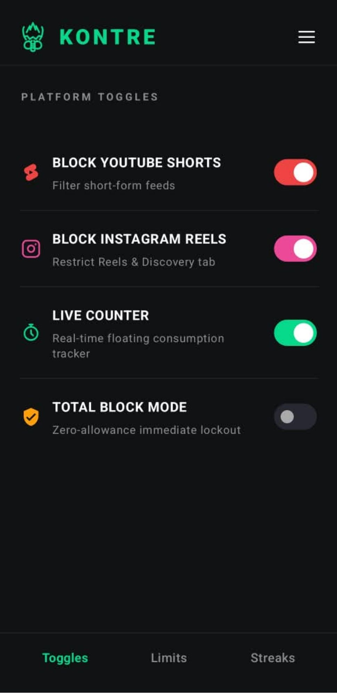 | 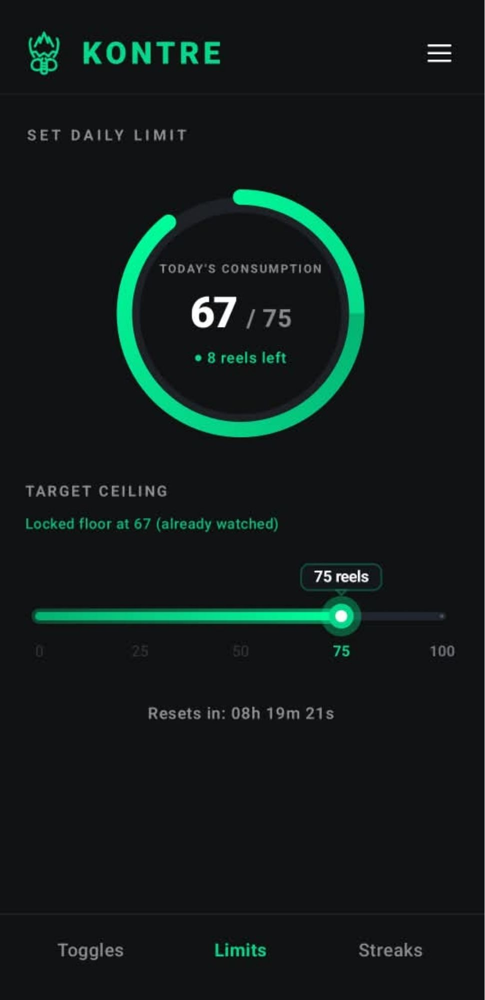 |
| *Breathing Dragon Mascot & Fast Initialization* | *Surgical Switches for Shorts, Reels & HUD* | *Radial Consumption Dial & Locked Floor Slider* |

---

### 🐉 Gamified Streaks: The 5 Dragon Evolution Stages

Break your compulsive doom-scrolling habits and watch your companion evolve as your discipline grows:

| 🥚 Stage 1: Egg (Day 1–3) | 🐣 Stage 2: Hatchling (Day 4–10) | 🐲 Stage 3: Small Dragon (Day 11–24) |
| :---: | :---: | :---: |
| 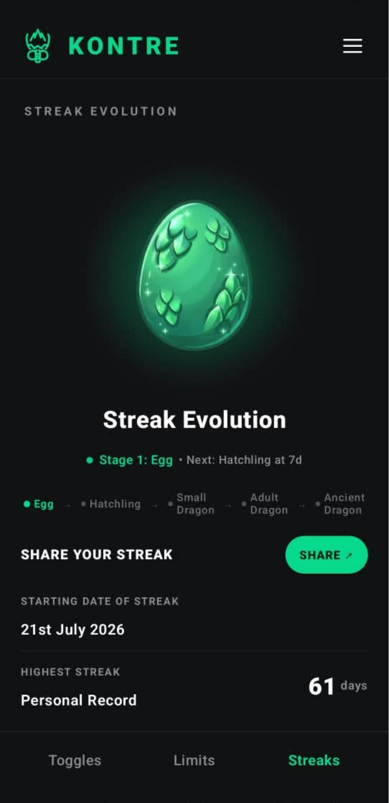 | 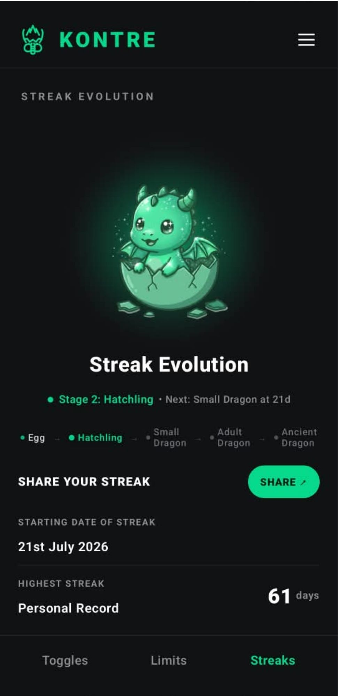 | 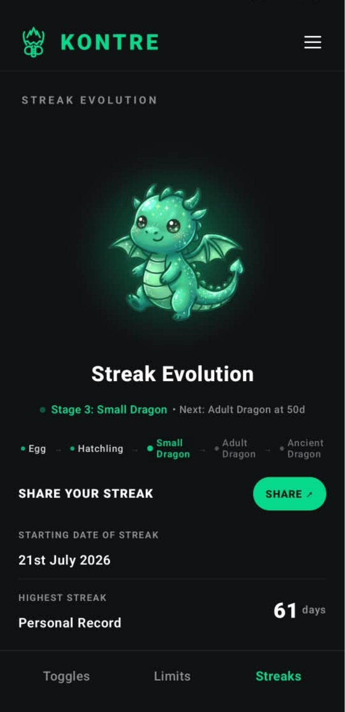 |
| **Dormant Ember Egg**<br>Glowing with subtle green ember veins. | **Sprout Hatchling**<br>Freshly hatched from the shell with curious eyes. | **Neon Wyrmling**<br>Sprouting wings and learning flight. |

| 🐉 Stage 4: Adult Dragon (Day 25–49) | 👑 Stage 5: Ancient Dragon (Day 50+) | ⚙️ Settings & Info Vault |
| :---: | :---: | :---: |
| 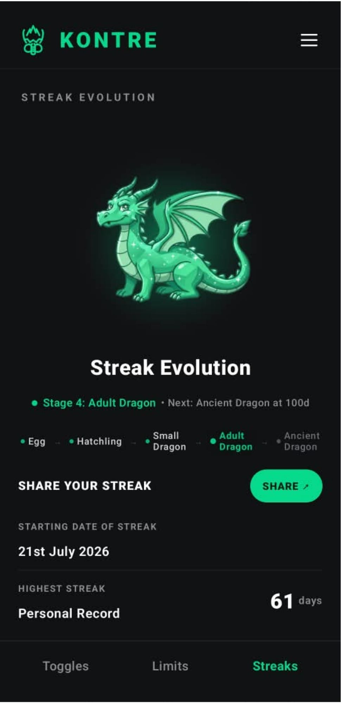 | 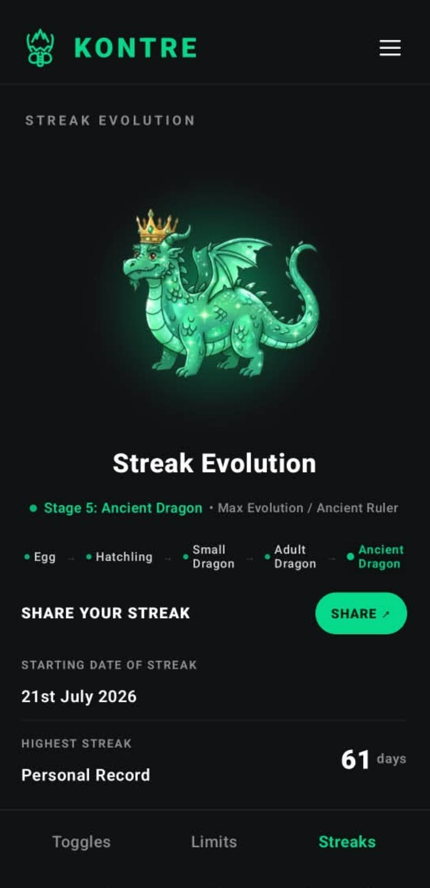 | 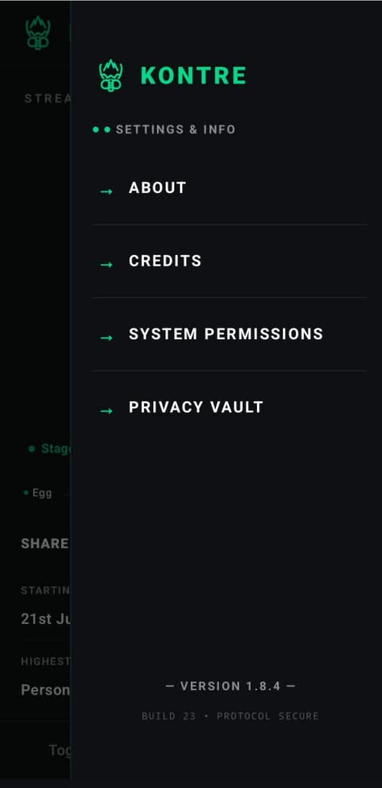 |
| **Verdant Drake**<br>Full-grown wingspan, muscular stance. | **Apex Kontre (Ancient Ruler)**<br>Crowned with gold and pulsing emerald aura. | **Settings Drawer**<br>Access About, Credits, Matrix & Privacy Vault. |

---

## 📖 The Legend of Hero Dragon Kontre

> *"Technology should be an instrument of your ambitions, not a slot machine tuned to exploit evolutionary neurochemistry."*

### Prologue // The Age of the Infinite Trance
In the golden era of human innovation, a subtle catastrophe enveloped civilization. The **Great Feed**—an omniscient labyrinth of neural prediction algorithms—learned to whisper to the most vulnerable corners of the human psyche.

Seconds dissolved into hours. Creative fires turned to ash. Ambitions eroded beneath the cold, hypnotic luminescence of vertical glass. Billions found themselves trapped in a waking trance, endlessly scrolling through ephemeral fragments of manufactured reality.

### Chapter I // The Awakening of Kontre
From the quiet rebellion of the sovereign human will arose **Kontre**—an ancient guardian dragon reborn in cyber-fire and obsidian scale. Kontre is not an instrument of punishment, but a shield of deliberate human power.

Bearing eyes of luminous emerald and wings forged from unshakeable resolve, Kontre cuts through algorithmic illusions. Kontre represents the innate defiance that refuses to have its attention harvested for shareholder dividends.

### Chapter II // The Covenant of Sovereignty
Kontre enters into a solemn covenant with you: you define your daily boundary, and the Dragon honors it with uncompromising discipline.

As long as you browse with purpose and intention, Kontre slumbers in silent protection. But the moment compulsive consumption breaches your declared limit, the Dragon ignites—severing the infinite feed, shattering the dopamine loop, and returning you to the physical universe where your real legacy awaits.

---

## ✨ Key Features & Technical Highlights

### 1. 🎯 Surgical Vertical Video Interception
Unlike blunt app-blockers that lock you out of Instagram or YouTube entirely, Kontre operates with surgical precision:
- **Instagram Reels:** Intercepts and blocks vertical Reels feeds while keeping **Direct Messages (DMs)**, **Stories**, and **Photo Feed** 100% accessible.
- **YouTube Shorts:** Intercepts and blocks the infinite Shorts feed while leaving **long-form videos**, **tutorials**, **study channels**, and **search** untouched.
- **Graceful Home Redirection:** Instead of crashing or abruptly killing the app, Kontre smoothly clicks the **Home** navigation tab or triggers a rate-limited back action, returning you safely to your productive workflow.

### 2. 🏷️ Real-Time Draggable Floating Counter HUD
- **Appears only inside video feeds:** Automatically mounts a sleek floating pill (`74 / 80`) when you enter a Short or Reel.
- **Fluid Repositioning:** Touch and drag the badge anywhere on screen; it smoothly tracks your touch and clamps within display edges.
- **Position Persistence:** Remembers your custom coordinates across app launches.
- **Zero Duplicates:** Single-instance overlay lifecycle guarantees ghost popups never occur.

### 3. 🛡️ Locked Floor Protection
- Protects users from their own impulse compromises.
- Once you have consumed e.g. 74 videos, Kontre dynamically locks the target ceiling slider floor at **74 reels**. You cannot lower the ceiling below what you have already watched today to "cheat" your streak.

### 4. 🔒 100% Air-Gapped Privacy & Zero Telemetry
- **No Cloud Servers:** Zero network calls. No user tracking, behavioral analytics, or third-party SDKs.
- **On-Device Heuristics:** Evaluates view hierarchy trees purely in volatile Android RAM.
- **No Database Bloat:** Runs entirely on encrypted local preferences without heavy database overhead.

---

## 🏛️ Architecture & Core Components

```
com.kontre.app
├── MainActivity.kt                      # Jetpack Compose single-activity orchestrator
├── data/
│   └── QuotaManager.kt                  # Reactive SharedPreferences state engine (StateFlow)
├── service/
│   ├── ContentTrackerService.kt         # Heuristic view tree scanner & 250ms liveness watchdog
│   ├── VideoBlockerAccessibilityService # Primary accessibility service declaration
│   ├── FloatingCounterManager.kt        # Draggable window overlay with WindowManager bindings
│   ├── ReelSessionTracker.kt            # Unique video fingerprint tracker
│   └── KontreForegroundService.kt       # Persistent priority watcher
└── ui/
    ├── SplashScreen.kt                  # Emerald breathing dragon cold-start loader
    ├── PlatformTogglesScreen.kt         # Granular toggle controls
    ├── SetDailyLimitScreen.kt           # Custom neon slider & radial consumption gauge
    ├── StreakEvolutionScreen.kt         # 5-stage dragon evolution engine & streak cards
    ├── AboutLoreScreen.kt               # Story of Kontre & architect profile
    ├── CreditsScreen.kt                 # Architectural & engineering attributions
    ├── PermissionsMatrixScreen.kt       # Interactive hardware permission checker
    └── PrivacyVaultScreen.kt            # On-device cryptographic privacy manifesto
```

---

## ⚙️ Required Permissions

| Permission | Purpose |
| :--- | :--- |
| **Accessibility Service** | Enables Kontre's on-device tree scanner to detect vertical video containers and execute graceful home redirection when your daily quota is hit. |
| **Display over other apps** (`SYSTEM_ALERT_WINDOW`) | Renders the draggable floating HUD counter pill over active short-form feeds. |
| **Battery Optimization Exemption** | Prevents aggressive OEM background cleaners from killing the watchdog service. |

---

## 📥 Download & Installation

### Option 1: Direct APK Download
Download the signed release APK directly from GitHub Releases:
- **[Latest Release (v1.8.6)](https://github.com/psk22/kontre/releases/latest)**

### Option 2: Build From Source
```bash
# Clone the repository
git clone https://github.com/psk22/kontre.git
cd kontre/ReelShield

# Build debug or release APK
./gradlew assembleDebug

# Install to connected device via ADB
adb install -r app/build/outputs/apk/debug/app-debug.apk
```

---

## 👨‍💻 Creator & Systems Architect

- **Pranava Siva Karthik Yadam** ([@psk22](https://github.com/psk22))  
  *Creator, Lead Systems Architect & Designer*

---

## 📄 License

This project is open-source and licensed under the **MIT License**.  
See the full text in the [LICENSE](LICENSE) file.

```
MIT License
Copyright (c) 2026 Pranava Siva Karthik Yadam (psk22) & Kontre Contributors
```
